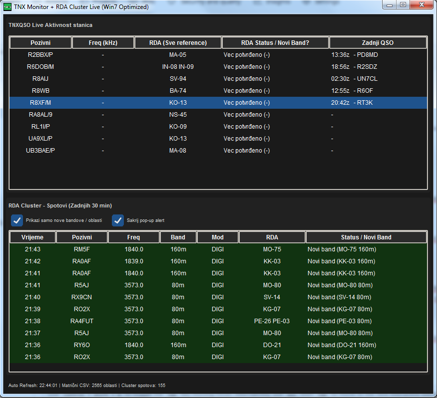
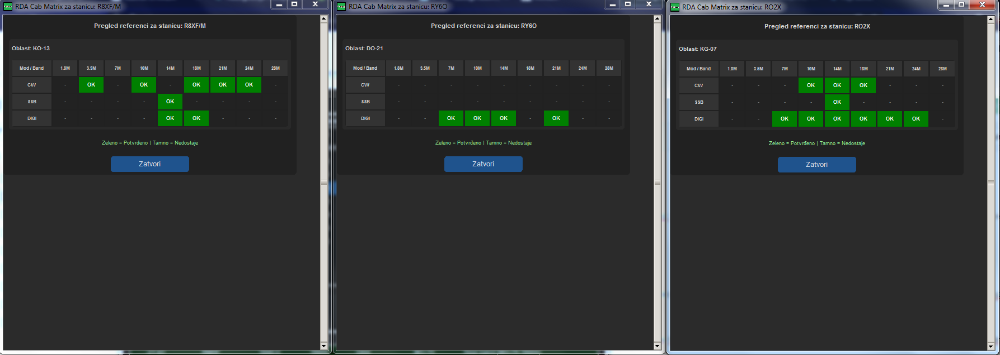
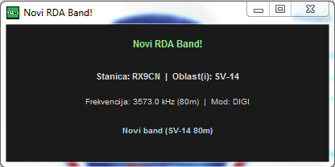

# TNXQSO-RDA-tracker
<p align="left">
  
</p>

<p align="left">
  
</p

<p align="center">
  
</p>


# TNX Monitor + RDA Cluster Live 📡

An advanced Python monitoring application designed for amateur radio operators targeting the **RDA (Russian District Award)** program. 

The application aggregates real-time station activity from `tnxqso.com` and live cluster spots from `rdacabinet.ru` (via Socket.IO WebSocket streams). It automatically cross-references active stations against your local RDA matrix CSV (`rda_slots.csv`) to provide instant visual and acoustic alerts for unworked bands and all-time-new areas.

---

## ✨ Features

* **Automated Log Matrix Sync**: Automatically downloads and parses the latest matrix CSV file from your `cfmrda.ru` hunter profile on startup to maintain up-to-date slot tracking.
* **Dual Monitoring Windows**:
  * **TNXQSO Live Table**: Real-time monitoring of active stations broadcasting from RDA areas.
  * **RDA Cluster Table**: Real-time Socket.IO spot feed maintained on a rolling 30-minute window.
* **Smart Alert Engine**:
  * **All-Time-New RDA Alerts**: Instant pop-up and sound alert for unworked RDA areas (`🔴 ALL-TIME-NEW`).
  * **New Band Alerts**: Triggered only when an active station operates in an area where you have zero confirmed contacts on that specific amateur band (ignores redundant mode alerts to eliminate noise).
  * **QSY Tracking**: Detects frequency and band shifts of active stations on `tnxqso.com`.
  * **Personal Callsign Hit Alert (`9A5CW`)**: Dedicated top-priority pop-up when your callsign appears in an active operator's online log.
* **Visual Status Indicators**:
  * Stations offering needed bands or areas are highlighted in **bold red** (`#ff4444`) within the live view table.
  * Cluster rows are dynamically color-coded based on slot status.
* **Filter & Mute Controls**:
  * **Show Only Needed**: Toggle filter to display only new band/area spots in the cluster list.
  * **Hide Pop-up Alert**: Mutes spot pop-ups while keeping personal log hits (`9A5CW`) active.
* **Interactive RDA Matrix Viewer**: Click any RDA reference to open an interactive modal grid displaying confirmed (`✓`) vs. unworked (`-`) slots across all bands (160m–10m) and modes (CW, SSB, DIGI).
* **Cross-Platform & Win7 Compatible**:
  * Styled with `CustomTkinter` in a modern "Black Night" dark theme.
  * Optimized string parsing and encoding fallback to ensure 100% compatibility with Windows 7 and legacy Python runtimes (avoids Python 3.8+ syntax such as walrus operators).

---

## 📋 Prerequisites & Installation

Ensure you have Python installed, then install the required dependencies:

```bash
pip install requests customtkinter python-socketio websocket-client
```

---

## 🚀 Running the Application

Place your window icon (`tnxqso2.ico`) in the application root directory and execute:

```bash
python tnxqso25.py
```

---

## 🛠️ Compiling to a Standalone Executable (.exe)

You can package the application into a single executable file for Windows (including Windows 7) using **PyInstaller**:

1. Install PyInstaller if you haven't already:
   ```bash
   pip install pyinstaller
   ```

2. Run the build command from the application root folder:
   ```bash
   pyinstaller --noconsole --onefile --icon=tnxqso2.ico --add-data "tnxqso2.ico;." tnxqso25.py
   ```

3. The generated executable will be saved in the `dist/` directory.

> **Note:** Ensure `rda_slots.csv` remains in the same directory as your compiled `.exe` file so the application can load and save your matrix data upon launch.

---

## 📐 Supported Amateur Bands

* **160m** (1.8 MHz)
* **80m** (3.5 MHz)
* **40m** (7.0 MHz)
* **30m** (10.1 MHz)
* **20m** (14.0 MHz)
* **17m** (18.068 MHz)
* **15m** (21.0 MHz)
* **12m** (24.89 MHz)
* **10m** (28.0 MHz)
* 

### Buy me a coffee : https://www.paypal.com/paypalme/9a5cw
